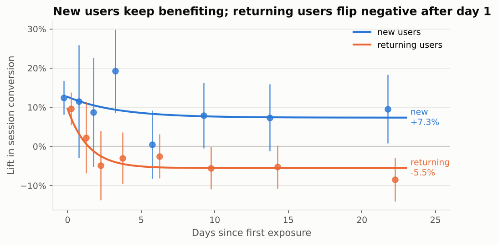

# From Reviews to Revenue: NLP-driven A/B testing for a food platform

An end-to-end data science project in the shape of a real product-company problem:

1. **NLP on restaurant reviews**: sentiment, topic modeling, and complaint categories tied to star ratings.
2. **An A/B test of a feature built from that NLP** ("Review Highlights"), with a power analysis written *before* the test.
3. **The three traps** that turn winning dashboards into losing launches: peeking, a novelty effect, and a segment where the effect reverses.
4. **A business recommendation** for marketing direction, sized in orders and revenue.

> **Everything here is synthetic.** Reviews are generated (by an LLM, or by an offline fallback) and the experiment is simulated with planted effects. That is a feature, not a bug: because the ground truth is known, every method can be *scored*, not just run. The numbers are illustrative; the methods and reasoning transfer.

---

## Headline results

| | |
|---|---|
| Costliest complaint | **Delivery delay**: in ~41% of 1-2★ reviews, ≈1.2★ lost when present |
| Topic model's blind spot | Hygiene (2% of reviews, most severe) never forms its own topic |
| Power analysis | 29,158 users/arm for a +5% MDE; we ran 28 days instead of the minimum 17, and explain why |
| Headline test result | **+7.2%** 7-day conversion (95% CI +4.7% to +9.7%, p < 0.001) |
| Dashboard on day 1 | **+37%** (what you'd have reported if you peeked and stopped) |
| Daily peeking false-positive rate | **29%** in A/A simulation vs 5.0% with pre-registered O'Brien-Fleming looks |
| Long-run effect, everyone | **−1.4%** (CI includes 0): the lift was mostly novelty |
| Long-run, new vs returning | **+7.6%** vs **−5.6%**: the effect reverses for returning users |
| Decision | Ship to new users only: **+2.4%** steady-state orders (CI +0.9% to +3.9%) vs −1.4% for a full rollout |

Full memo: [`reports/RECOMMENDATION.md`](reports/RECOMMENDATION.md)



---

## Notebooks (read in order)

| # | Notebook | What it answers |
|---|---|---|
| 01 | [`01_review_nlp.ipynb`](notebooks/01_review_nlp.ipynb) | Which complaints drive low ratings? What do happy customers praise? |
| 02 | [`02_power_analysis.ipynb`](notebooks/02_power_analysis.ipynb) | How many users, how long, which stopping and decision rules (pre-registered) |
| 03 | [`03_ab_test_analysis.ipynb`](notebooks/03_ab_test_analysis.ipynb) | SRM check, primary metric, CUPED, guardrails, segments with corrections |
| 04 | [`04_traps_and_recommendation.ipynb`](notebooks/04_traps_and_recommendation.ipynb) | Peeking, novelty, segment reversal, then the sized decision |

All notebooks are committed **with outputs**, so they read on GitHub without running anything.

## Things this project does deliberately (good interview material)

* **Latent structure first, text second.** Ratings and complaints are sampled from a J-shaped distribution, then the LLM writes text to match. Asking an LLM for "3,000 reviews" gives you polite, uniform, mostly-4★ text and no way to validate anything.
* **Shows its failures.** The first topic-model attempt (whole reviews, full corpus) produced "positive review / negative review" topics. Notebook 01 explains each fix, shows a topic that merges "forgot *half* the order" with "an hour and a *half*", and shows that coherence alone picks the wrong k.
* **Reports when a technique didn't help.** CUPED cut variance by ~2% here, and the notebook explains why (binary short-window metric, 55% of users have no pre-period history).
* **Keeps an inconvenient false positive.** The city-tier interaction is "significant" (p ≈ 0.003) and is pure noise by construction. We kept that seed instead of shopping for a cleaner one, and show how you'd catch it without an answer key.
* **Robustness across 20 seeds.** `scripts/seed_robustness.py` reruns the whole experiment: the headline win and the hidden returning-user reversal appear in 20/20 draws, and a full rollout is flat-or-negative long-run in 17/20.
* **Clustered standard errors** whenever sessions are analysed (users are the randomization unit).

## Repo layout

```
├── data/
│   ├── raw/                 reviews.csv, experiment_users.parquet, experiment_sessions.parquet
│   └── processed/           reviews_enriched.csv, seed_robustness.csv
├── notebooks/               01-04, executed
├── reports/
│   ├── RECOMMENDATION.md    the business memo
│   └── figures/             every chart, as PNG
├── scripts/
│   ├── generate_reviews_llm.py      review text via Claude (needs ANTHROPIC_API_KEY)
│   ├── generate_reviews_offline.py  template fallback, no key needed
│   └── seed_robustness.py
├── src/
│   ├── config.py            paths + the pre-registered experiment design
│   ├── generation.py        latent review structure shared by both generators
│   ├── nlp/                 sentiment.py, topics.py, complaints.py
│   ├── experiment/          simulate.py, power.py, analysis.py, traps.py
│   └── plotting.py
└── tests/test_stats.py      power formula vs statsmodels & simulation, CI coverage, OBF, SRM, lexicon edge cases
```

## Run it

```bash
python -m venv .venv && source .venv/bin/activate
make install
make all          # offline data → seed robustness → execute notebooks → tests
```

To regenerate reviews with an LLM instead of templates:

```bash
export ANTHROPIC_API_KEY=sk-ant-...
python scripts/generate_reviews_llm.py --limit 50   # smoke test first
make data-llm notebooks
```

The LLM script is resumable (caches to `data/raw/_llm_cache.jsonl`) and defaults to a small model; override with `REVIEW_MODEL=...`. Check current API pricing before generating all 3,000.

## Honest limitations

* **The committed reviews come from the offline template generator**, because the LLM run needs an API key. Template text is easy for NLP: the near-perfect lexicon scores and the 0.97 supervised F1 are upper bounds. Expect them to drop on LLM text and drop further on real reviews.
* **The complaint lexicon was written after reading the corpus.** On real data, hand-label ~300 reviews and score against those. The natural upgrade is a zero-shot LLM classifier evaluated on the same labelled set.
* **The experiment is simulated with effects we planted.** The value is in showing that the analysis *recovers* them (and where it gets fooled), not in the effect sizes.
* **Star-impact coefficients are associations** from an OLS on a bounded 1-5 scale; severe complaints at the 1★ floor (hygiene) are understated.

## Possible extensions

* Zero-shot LLM complaint classifier + a hand-labelled evaluation set
* BERTopic on the LLM-generated corpus, compared against NMF
* Always-valid inference (mSPRT) as an alternative to group-sequential looks
* A follow-up test: Review Highlights *without* the caveat line, for returning users
